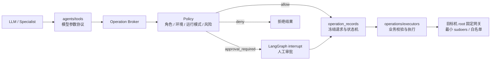

# Agent 操作执行架构

这套架构把“模型会调用什么”“系统是否允许”“实际怎么执行”分成独立层，避免把审批、SSH、
数据库校验和 LangGraph 路由混在同一个节点里。

## 各层职责

- `agents/tools/`：只定义模型可见的工具名、参数 schema 和使用说明，不持有写操作业务实现。
- `agents/tools/catalog.py`：登记每项操作的读写属性、风险等级和审批展示；读写工具不能重名。
- `operations/broker.py`：唯一操作入口，先查注册表、再调用策略、最后调度获配执行器。
- `operations/policy.py`：纯规则判断，不访问数据库、不连接服务器，输出 `allow / approval_required / deny`。
- `operation_records`：保存规范化参数、摘要、发起人、审批人、策略上下文、状态和结果；执行前使用行锁，避免重复执行。
- `operations/executors/`：执行数据库复查、SSH/SFTP 和业务逻辑；即使上层批准，也不能绕过服务目录授权和参数校验。
- `scripts/target-server/`：最终权限边界。SSH 用户不能修改 root 包装脚本，sudoers 只放行固定入口，不开放任意 Shell。

## 默认策略

- 读操作允许在交互会话和无人值守任务中运行。
- `viewer` 和 `system` 不能发起写操作；`operator / approver / admin` 可以发起。
- 写操作默认需要人工审批，只有 `approver / admin` 可以批准。
- `high` 操作仍需要详情弹窗二次确认；`critical` 操作始终拒绝执行，只能给建议。
- 无人值守任务始终拒绝写操作。
- `OPERATION_AUTO_APPROVE_NON_PRODUCTION_MEDIUM=true` 时，仅明确标记为非生产环境的 `medium` 操作可自动放行；生产、未知环境和高风险操作不受影响。

当前项目还没有登录鉴权，交互会话的可信身份暂时来自服务端 `OPERATION_ACTOR_ID` 和
`OPERATION_ACTOR_ROLE`，不能由前端请求自行声明。以后接入认证时，应由认证依赖构造同一份
`OperationContext`，Broker、策略和执行器无需重写。

## 新增写操作的固定步骤

1. 在 `agents/tools/` 定义薄 Tool，只负责参数协议。
2. 在 `operations/executors/` 实现业务复查和执行，不接受任意 Shell 文本。
3. 在工具目录登记 `effect=write`、风险等级和审批展示构造器。
4. 如需目标机 root 权限，在 `scripts/target-server/` 增加固定参数网关和精确 sudoers，不直接授权底层命令。
5. 增加策略边界、未审批不可执行、执行器白名单和审计状态测试。

审计查询接口是 `GET /operations`，可使用 `chat_run_id`、`status` 和 `limit` 筛选。
