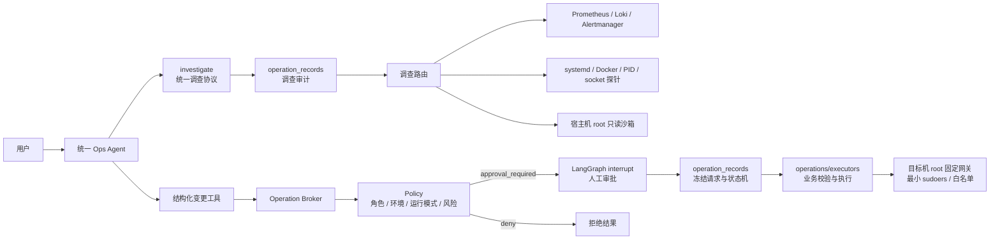

# Agent 操作执行架构

这套架构把“Agent 表达调查或变更意图”“系统是否允许”“实际怎么执行”分成独立层。对 Agent
和用户只有调查、变更两个概念；底层仍按数据源和权限边界选择不同执行器。



## 各层职责

- `agents/tools/investigation.py`：模型唯一可见的调查入口；把证据领域、目标和筛选条件路由给内部读执行器，并统一补充证据来源。
- `agents/tools/` 的其他读模块：Prometheus、Loki、运行时和文件调查实现，不直接绑定给模型。
- 结构化写 Tool：只定义参数 schema 和使用说明，不持有写操作业务实现。
- `agents/tools/catalog.py`：登记每项操作的读写属性、风险等级和审批展示；读写工具不能重名。
- `operations/broker.py`：唯一操作入口，先查注册表、再调用策略、最后调度获配执行器。
- `operations/policy.py`：纯规则判断，不访问数据库、不连接服务器，输出 `allow / approval_required / deny`。
- `operation_records`：所有调查以独立 `execution_id` 保存统一请求、证据目标和脱敏结果；交互操作额外关联 `chat_run_id`，无人值守调查也能审计。写操作保存冻结请求、审批和状态机，且必须绑定真实 Chat Run。
- `operations/executors/`：执行数据库复查、SSH/SFTP 和业务逻辑；即使上层批准，也不能绕过服务目录授权和参数校验。
- `scripts/target-server/root-read/`：宿主机通用只读边界。后端可进入宿主机真实根目录执行程序，也可在内部工具箱中用 `rg/find/jq` 搜索宿主文件；两者都运行在无网络的一次性容器中，宿主根只读，敏感路径以 `AIOMS_PATH_MASKED` 明示遮蔽。执行语境由后端选择，不暴露给 Agent。
- `scripts/target-server/` 的其他目录：写操作最终权限边界。SSH 用户不能修改 root 包装脚本，sudoers 只放行固定参数入口，不开放任意宿主机写 Shell。

## 默认策略

- `investigate` 自动允许，无需人工审批；交互式与无人值守调查都必须先成功落审计记录，审计不可用时不执行。
- 宿主机程序版本、PATH 和绝对路径由宿主机只读语境核验；Agent 不再选择容器语境或拼接内部挂载路径。被遮蔽路径只能报告无法读取，不能判断为空或不存在。
- `viewer` 和 `system` 不能发起写操作；`operator / approver / admin` 可以发起。
- 写操作默认需要人工审批，只有 `approver / admin` 可以批准。
- `high` 操作仍需要详情弹窗二次确认；`critical` 操作始终拒绝执行，只能给建议。
- 无人值守任务始终拒绝写操作。
- `OPERATION_AUTO_APPROVE_NON_PRODUCTION_MEDIUM=true` 时，仅明确标记为非生产环境的 `medium` 操作可自动放行；生产、未知环境和高风险操作不受影响。

当前项目还没有登录鉴权，交互会话的可信身份暂时来自服务端 `OPERATION_ACTOR_ID` 和
`OPERATION_ACTOR_ROLE`，不能由前端请求自行声明。以后接入认证时，应由认证依赖构造同一份
`OperationContext`，Broker、策略和执行器无需重写。

## 新增写操作的固定步骤

1. 在 `agents/tools/` 定义薄 Tool，只负责参数协议。
2. 在 `operations/executors/` 实现业务复查和执行，不接受任意 Shell 文本。
3. 在工具目录登记 `effect=write`、风险等级和审批展示构造器。
4. 如需目标机 root 权限，在 `scripts/target-server/` 增加固定参数网关和精确 sudoers，不直接授权底层命令。
5. 增加策略边界、未审批不可执行、执行器白名单和审计状态测试。

审计查询接口是 `GET /operations`，可使用 `execution_id`、`chat_run_id`、`status` 和 `limit` 筛选。

## 已有开发数据库升级

`create_all()` 不会修改已经存在的表。已有本地 `operation_records` 需要执行一次：

```bash
cd backend
uv run python scripts/migrate_operation_records.py
```

脚本执行的核心 SQL 如下，供人工核对：

```sql
BEGIN;
ALTER TABLE operation_records ADD COLUMN IF NOT EXISTS execution_id uuid;
UPDATE operation_records
SET execution_id = chat_run_id
WHERE execution_id IS NULL;
ALTER TABLE operation_records ALTER COLUMN execution_id SET NOT NULL;
ALTER TABLE operation_records ALTER COLUMN chat_run_id DROP NOT NULL;
ALTER TABLE operation_records
  DROP CONSTRAINT IF EXISTS uq_operation_records_run_tool_call;
ALTER TABLE operation_records
  DROP CONSTRAINT IF EXISTS uq_operation_records_execution_tool_call;
ALTER TABLE operation_records
  ADD CONSTRAINT uq_operation_records_execution_tool_call
  UNIQUE (execution_id, tool_call_id);
ALTER TABLE operation_records ADD COLUMN IF NOT EXISTS exit_code integer;
ALTER TABLE operation_records ADD COLUMN IF NOT EXISTS timed_out boolean;
ALTER TABLE operation_records DROP CONSTRAINT IF EXISTS ck_operation_records_effect;
ALTER TABLE operation_records
  ADD CONSTRAINT ck_operation_records_effect CHECK (effect IN ('read', 'write'));
ALTER TABLE operation_records DROP CONSTRAINT IF EXISTS ck_operation_records_risk_level;
ALTER TABLE operation_records
  ADD CONSTRAINT ck_operation_records_risk_level
  CHECK (risk_level IN ('low', 'medium', 'high', 'critical'));
COMMIT;
```
